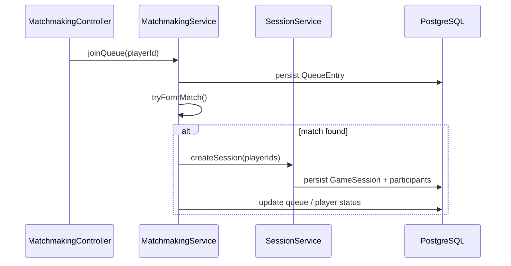

# MatchForge — Architecture

## Architectural style

**Modular monolith:** one deployable Spring Boot application, logically split into **feature modules** that own their web, service, persistence, and DTO types. Shared infrastructure lives in `common`. This keeps EA-relevant concerns visible (matchmaking, sessions, player data) without premature microservice extraction.

### Rationale

- Single JVM simplifies local dev, tests, and Docker for an internship portfolio.
- Feature folders enforce boundaries and mirror how game backends often group teams (player services vs. matchmaking).
- We can extract a module to a separate service later without rewriting domain logic if package boundaries stay clean.

## Layering (per feature module)

Each feature follows the same vertical slice:

```
HTTP (controller)
    → application service (use cases, transactions)
        → repository (Spring Data JPA)
            → entity (persistence model)
```

| Layer | Responsibility | Must not |
|-------|----------------|----------|
| `web` | REST mapping, status codes, DTO in/out | Access repositories directly |
| `service` | Business rules, orchestration, `@Transactional` | Know about HTTP |
| `repository` | Persistence queries | Contain business rules |
| `domain` / `entity` | DB mapping, enums | Appear in API responses |
| `dto` | API contracts, validation annotations | JPA annotations |

**Dependency rule:** `web` → `service` → `repository` → `entity`. `dto` is used by `web` and sometimes `service` for boundaries. `common` is depended upon by all features; features do not depend on each other’s internals—only on **published service APIs** when orchestration requires it (e.g. matchmaking calling session creation).

## Cross-cutting concerns (`common`)

| Concern | Approach |
|---------|----------|
| Identifiers | UUID for all aggregate roots |
| Timestamps | `Instant` or `OffsetDateTime` on base audit fields (created/updated) |
| Validation | Jakarta Validation on request DTOs; `@Valid` on controller parameters |
| Errors | `common.error.GlobalExceptionHandler` + `ErrorResponse` (status, message, field errors) |
| Logging | SLF4J; INFO for lifecycle events, DEBUG behind profile |
| Configuration | `@ConfigurationProperties` where grouped settings emerge (matchmaking thresholds) |

## Proposed package structure

Root application class remains at the base package. **Recommended base package:** `com.matchforge` (flatten Initializr’s `com.matchforge.matchforge` when implementing Phase 0—single rename of the main class package).

```
com.matchforge
├── MatchforgeApplication.java
│
├── common
│   ├── error
│   │   ├── ErrorResponse.java
│   │   ├── ResourceNotFoundException.java
│   │   ├── ConflictException.java
│   │   └── GlobalExceptionHandler.java
│   ├── persistence
│   │   ├── BaseEntity.java          # id (UUID), createdAt, updatedAt
│   │   └── UuidGenerator.java       # only if not using @GeneratedValue strategy
│   └── config
│       ├── JpaAuditingConfig.java   # optional, when audit fields added
│       └── WebConfig.java             # CORS etc. if needed later
│
├── player
│   ├── web
│   │   └── PlayerController.java
│   ├── service
│   │   └── PlayerService.java
│   ├── repository
│   │   └── PlayerRepository.java
│   ├── domain
│   │   ├── Player.java
│   │   └── PlayerStatus.java          # e.g. OFFLINE, AVAILABLE, IN_QUEUE, IN_SESSION
│   └── dto
│       ├── CreatePlayerRequest.java
│       ├── UpdatePlayerRequest.java
│       ├── SetAvailabilityRequest.java
│       └── PlayerResponse.java
│
├── matchmaking
│   ├── web
│   │   └── MatchmakingController.java
│   ├── service
│   │   ├── MatchmakingService.java
│   │   └── MatchmakingPolicy.java     # skill window, team size (plain class, no extra framework)
│   ├── repository
│   │   └── QueueEntryRepository.java
│   ├── domain
│   │   ├── QueueEntry.java
│   │   └── QueueStatus.java
│   └── dto
│       ├── JoinQueueRequest.java
│       ├── QueueStatusResponse.java
│       └── MatchResultResponse.java   # optional expose when match created
│
└── session
    ├── web
    │   └── SessionController.java
    ├── service
    │   └── SessionService.java
    ├── repository
    │   └── GameSessionRepository.java
    ├── domain
    │   ├── GameSession.java           # "Session" conflicts with HTTP session; use GameSession in code
    │   ├── SessionParticipant.java
    │   └── SessionState.java
    └── dto
        ├── SessionResponse.java
        ├── SessionParticipantResponse.java
        └── UpdateSessionRequest.java
```

### Module interaction (match formation)



`MatchmakingService` depends on **`SessionService` public interface** (constructor-injected), not on `SessionRepository`, to keep session invariants inside the session module.

## Persistence

- **PostgreSQL** as sole datastore in v1.
- Spring Data JPA repositories; avoid native SQL unless query complexity demands it.
- Schema management (Phase 0): `ddl-auto: update` in default/`application.yml` for local and Docker dev; production profile will move to `validate` + migrations in a later phase.
- Relationships:
  - `GameSession` 1—* `SessionParticipant` *—1 `Player` (by UUID reference).
  - `QueueEntry` references `Player` by `playerId` (FK).

## API conventions

- Prefix: `/api/v1`.
- JSON field names: `camelCase`.
- UUIDs in path and body as standard string format.
- `POST` creation returns `Location` header optional; minimum `201` with body.
- Idempotent leave-queue: repeated `DELETE` → `204` even if not in queue (or `404`—pick one in Phase 2 and test it).

## Testing strategy

| Scope | Tooling | Target |
|-------|---------|--------|
| Unit | JUnit 5, Mockito | `MatchmakingPolicy`, state transitions in `SessionService` |
| Web slice | `@WebMvcTest` + MockMvc | Controllers, validation, exception mapping |
| Data slice | `@DataJpaTest` | Repositories, UUID mapping |
| Integration | `@SpringBootTest` | Critical flows; Testcontainers Postgres in Phase 4 if desired |

Never assert “tests pass” in commits without CI or local `mvn test` output.

## Security (deferred)

v1 APIs are **open** behind a private network or local dev. Document in a future ADR if we add:

- Spring Security with API keys, or
- JWT for player identity tied to `playerId`.

Registration then becomes the source of truth for identity until auth lands.

## DevOps (Phase 0)

```
/
├── Dockerfile                  # multi-stage build (JDK 21 → JRE 21)
├── docker-compose.yml          # postgres + app; app waits for DB health
├── .env.example                # credentials template (copy to .env)
├── .github/workflows/ci.yml    # compile, test, package on main PR/push
└── src/main/resources/
    └── application.yml         # DB_* env vars, JPA, Actuator, logging
```

Actuator exposes `/actuator/health` (DB contributes when the datasource is up). Compose uses curl-based app health checks.

## Architectural decision record (ADR) log

| ID | Decision | Status |
|----|----------|--------|
| ADR-001 | Modular monolith with feature packages | Accepted |
| ADR-002 | UUID primary keys for all aggregates | Accepted |
| ADR-003 | DTO boundary at REST layer | Accepted |
| ADR-004 | `GameSession` naming to avoid confusion with HTTP session | Accepted |
| ADR-005 | Dev schema via Hibernate `ddl-auto=update`; migrations deferred | Accepted (Phase 0) |
| ADR-006 | Error types live under `common.error` (not `exception`/`api`) | Accepted (Phase 0) |

---

See [PROJECT_SPEC.md](./PROJECT_SPEC.md) for roadmap and endpoint list. **Phase 0 foundation is implemented** (package layout, error handling, Postgres config, Docker, CI).