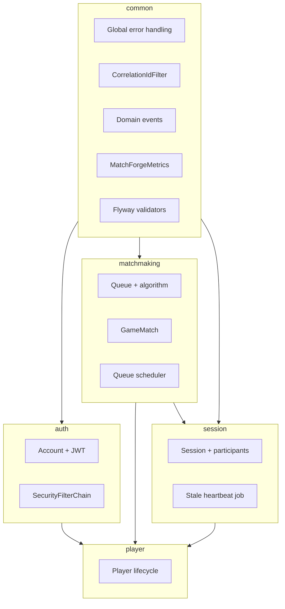
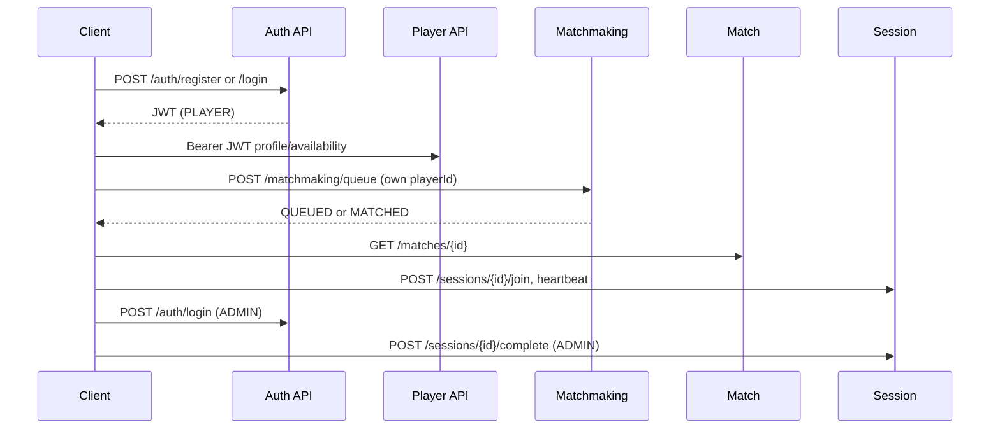

# MatchForge Architecture

## System overview

MatchForge is a **modular monolith** Spring Boot application that provides player profiles, skill-based 1v1 matchmaking, and multiplayer game session management over PostgreSQL.

| Layer | Technology |
|-------|------------|
| Runtime | Java 21 |
| Framework | Spring Boot 4.2 |
| Web | Spring WebMVC, Jakarta Validation |
| Security | Spring Security, OAuth2 Resource Server, HS256 JWT |
| Persistence | Spring Data JPA, Hibernate `validate`, Flyway |
| Database | PostgreSQL 16 |
| Observability | Actuator, Micrometer, Prometheus registry, correlation IDs |
| API docs | springdoc OpenAPI 3 (dev-oriented) |
| Build / CI | Maven, GitHub Actions, Testcontainers (Failsafe) |

Entry point: `com.matchforge.MatchforgeApplication`.

## Module boundaries

| Module | Responsibility | Does not |
|--------|----------------|----------|
| **common** | Shared errors, MDC, metrics, events, Flyway safety | Own business aggregates |
| **auth** | Credentials, JWT, roles, login lockout | Store gameplay skill/state |
| **player** | Profile, skill rating, availability, status lifecycle | Match or host sessions |
| **matchmaking** | Queue, pairing algorithm, match records | Session heartbeats |
| **session** | Session state machine, participants, heartbeats | Change skill ratings |

Cross-module rule: **matchmaking and session call `PlayerService` for player status**, not `PlayerRepository`.

## Main request flow

1. **Register** — `AuthService` creates `Player` + `Account` in one transaction; returns JWT.
2. **Login** — BCrypt verify; failed attempts tracked on `Account`; lockout is account-level (not IP rate limiting).
3. **Queue** — join triggers `MatchmakingService.tryFormMatch`; scheduled job also calls `processQueue()`.
4. **Match** — persists `game_matches`, creates session via `SessionService.createSessionForMatch`, publishes `MatchCreated` / `SessionCreated` events (after commit).
5. **Session** — participants join, heartbeats, disconnect/reconnect; **complete/cancel** require **ADMIN**.

## Database architecture

Flyway migrations (`src/main/resources/db/migration/`):

| Version | Purpose |
|---------|---------|
| V1 | Phase 0–3 baseline (`players`, `queue_entries`, `game_matches`, `game_sessions`, `session_participants`, partial unique index on active queue) |
| V2 | `accounts` (auth) |
| V3 | Login lockout columns on `accounts` |

All entities extend `BaseEntity` (UUID id, `created_at`, `updated_at`). Optimistic locking on `queue_entries.version`.

**Relationships (logical):**

- `accounts.player_id` → `players.id` (nullable for ADMIN)
- `queue_entries.player_id` → players
- `game_matches` references two players
- `game_sessions.match_id` unique → one session per match
- `session_participants` unique per (session, player)

**Existing DB adoption:** back up first; set `MATCHFORGE_FLYWAY_BASELINE=true` once on a complete Phase 0–3 database. `FlywayLegacySchemaValidator` refuses baseline when legacy tables are incomplete.

## Security architecture

- **Stateless** sessions; **CSRF disabled** (bearer API).
- **JWT** claims: `sub` (account id), `role`, optional `playerId`, `iss`, `exp`. Issuer validated on decode.
- **Roles:** `PLAYER`, `ADMIN` (no public ADMIN registration).
- **Authorization:** `@PreAuthorize` + `AuthorizationService` (`@authz`) — self-or-admin for player-scoped IDs; match/session participant checks; ADMIN for list players, session complete/cancel.
- **Secrets:** `MATCHFORGE_JWT_SECRET` (≥ 32 bytes), `MATCHFORGE_ADMIN_USERNAME` / `MATCHFORGE_ADMIN_PASSWORD` (both required if either set).
- **Login lockout:** `failed_login_attempts`, `locked_until` on `accounts`; configurable `max-failed-login-attempts` and `login-lockout-seconds`. Complement with gateway rate limiting in production.
- **Actuator:** health public; other actuator endpoints **ADMIN**. Swagger/OpenAPI **public in dev**, **disabled or ADMIN-only in prod** (`application-prod.yml`).

## Matchmaking design

- **Algorithm:** `MatchmakingAlgorithm` — rating window expands over wait time; pick smallest rating gap; FIFO tie-break.
- **Concurrency:** pessimistic locks on queue entries and ordered player locks in `tryFormMatch`.
- **Scheduler:** `MatchmakingQueueScheduler` (`@Profile("!test")`) periodically processes `findQueuedEntryIds()`.
- **Limitation:** pairing quality depends on queue depth and scheduler interval; not a global ELO service.

## Session design

- **States:** `WAITING_FOR_PLAYERS` → `ACTIVE` / `PAUSED` → `COMPLETED` / `CANCELLED` / `EXPIRED`.
- **Participants:** `PENDING` → `JOINED` ↔ `DISCONNECTED`.
- **Heartbeats:** timeout marks disconnect and may pause session; maintenance job (`@Profile("!test")`).
- **Completion:** ADMIN only — returns players to `AVAILABLE`.

## Observability

- **Correlation ID:** `X-Correlation-ID` filter → MDC `correlationId` → response header.
- **Metrics (low cardinality):** registrations, queue joins, matches, sessions created/completed/cancelled, auth failures, disconnections.
- **Events:** `MatchCreated`, `SessionCreated`, `SessionActivated`, `SessionCompleted`, `SessionCancelled` — published in transactions; `DomainEventListener` handles **after commit**.

## Deployment and testing

| Profile | Use |
|---------|-----|
| default / dev | Local API, Swagger enabled, dev JWT default |
| test | Integration tests, fixed admin bootstrap |
| prod | No Swagger, minimal errors, JWT secret required |

**Tests:**

- Surefire: unit + JDBC integration (excludes `@Tag("testcontainers")`).
- Failsafe: `*IT.java` with Testcontainers (requires Docker).
- **`./mvnw verify -Punit-only`** — skips Failsafe when Docker unavailable.

**CI:** `ubuntu-latest`, Postgres service, `docker info`, then `./mvnw clean verify` (Surefire + Failsafe).

**Compose:** Postgres host port **5433**; app uses Flyway on startup with `ddl-auto: validate`.

## Environment variables (production)

| Variable | Required in prod |
|----------|------------------|
| `DB_URL`, `DB_USERNAME`, `DB_PASSWORD` | Yes |
| `MATCHFORGE_JWT_SECRET` | Yes |
| `MATCHFORGE_ADMIN_USERNAME` + `MATCHFORGE_ADMIN_PASSWORD` | If bootstrapping admin |
| `MATCHFORGE_FLYWAY_BASELINE` | Only for legacy adoption (once) |

See `.env.example` and `README.md` for local setup.

## Hosted deployment (Phase 5)

- **Render** Docker web service — [`render.yaml`](./render.yaml), region `singapore`, free plan, health check `/actuator/health`.
- **Neon** PostgreSQL — external JDBC URL with `sslmode=require`; not provisioned by the Blueprint.
- **Production binding:** `server.address=0.0.0.0`, `server.port=${PORT:8080}`; Hikari pool sized for small containers.
- **Operator guide:** [docs/deployment.md](docs/deployment.md).