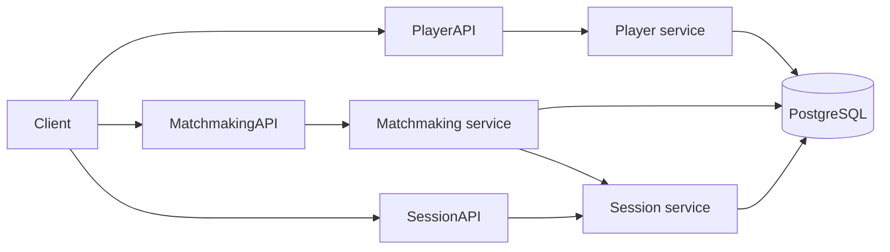

# MatchForge — Project Specification

## Purpose

MatchForge is a **multiplayer game backend and matchmaking platform** built to demonstrate production-oriented backend engineering and DevOps practices. It is intended as a portfolio artifact for an **Electronic Arts internship** application: readable architecture, automated tests, containerized deployment, and CI—not a commercial game client.

## Goals

| Goal | How we measure success |
|------|------------------------|
| Clear modular design | Features isolated under `player`, `matchmaking`, `session`, `common` |
| Production habits | DTOs, validation, centralized errors, UUID IDs, correct HTTP semantics |
| Operability | Docker, PostgreSQL, Actuator health, GitHub Actions CI |
| Quality | JUnit 5 + Mockito tests on each important behavior |
| Incremental delivery | Roadmap phases; no big-bang implementation |

## Non-goals (initial scope)

- Real-time gameplay simulation or game engine integration
- Full authentication/authorization (may add API keys or simple tokens later)
- Multi-region deployment or Kubernetes orchestration
- Client applications (mobile/desktop); APIs are the product surface
- Anti-cheat, billing, or live-ops tooling

## Domain overview

1. **Player** — Identity and profile for participants (display name, skill rating metadata, availability).
2. **Matchmaking** — Queue players by rules (e.g. skill band, party size) and produce **matches** (candidate session rosters).
3. **Session** — A formed match instance: participants, lifecycle state (e.g. `PENDING`, `ACTIVE`, `COMPLETED`, `CANCELLED`).

## Technology stack (as initialized)

| Layer | Choice |
|-------|--------|
| Language | Java 21 |
| Framework | Spring Boot **4.2.0** |
| Build | Maven (`mvnw`) |
| Persistence | Spring Data JPA, PostgreSQL driver |
| API | Spring WebMVC (`spring-boot-starter-webmvc`) |
| Validation | `spring-boot-starter-validation` (Jakarta Bean Validation) |
| Observability | Spring Boot Actuator |
| Testing | JUnit 5, Spring Boot test starters (incl. WebMVC/JPA test support) |
| Containers / CI | Docker (planned), GitHub Actions (planned) |

**Current repository state:** Phase 0–3 complete — player service, 1v1 matchmaking, automatic game session provisioning, heartbeat/disconnect/reconnect, stale-session maintenance, **52** automated tests.

## Engineering rules (binding)

- Modular monolith organized **by feature**, not by technical layer at the root.
- Constructor injection only; no field injection.
- **Never** return JPA entities from REST controllers; use request/response DTOs.
- Bean Validation on incoming DTOs; fail fast with `400 Bad Request`.
- Global `@RestControllerAdvice` for consistent error payloads and status codes.
- Entity primary keys: **UUID** (generated in the persistence layer or application).
- No secrets in git; configuration via environment variables and Spring profiles.
- Tests required for services and HTTP layers before claiming a feature “done.”
- No `TODO` for required behavior in merged work—implement or defer via roadmap, not placeholders.

## Development roadmap

### Phase 0 — Foundation (**complete**)

- Base package `com.matchforge` with `common.error` (`ErrorResponse`, `GlobalExceptionHandler`, domain exceptions).
- `application.yml` + `application-test.yml` with `DB_URL` / `DB_USERNAME` / `DB_PASSWORD`.
- Docker multi-stage image, Compose (Postgres + app), `.env.example`, CI workflow on `main`.
- Tests: context load (`@SpringBootTest`), exception handler (`@WebMvcTest`).

**Exit criteria:** Met locally with Postgres available; feature APIs still pending Phase 1+.

### Phase 1 — Player module

- `Player` entity, repository, service, controller.
- Register player, get by id, update profile fields, set online/availability flag.
- Integration tests with `@DataJpaTest` / `@WebMvcTest` / `@SpringBootTest` as appropriate.

**Exit criteria:** All player endpoints documented below implemented and tested.

### Phase 2 — Matchmaking module (**complete**)

- Queue join/leave/status APIs, 1v1 skill-window algorithm, `game_matches` persistence (not game sessions yet).
- Player lifecycle via `PlayerService` only; `PlayerStatus.MATCHED` when paired.
- PostgreSQL partial unique index on active queue rows; pessimistic locking for pairing.

**Exit criteria:** Two `AVAILABLE` players join queue and receive a `game_matches` record; tests cover algorithm, service, repository, HTTP, and concurrency.

### Phase 3 — Session module (**complete**)

- `game_sessions` + `session_participants`, automatic creation after match.
- Join, heartbeat, disconnect/reconnect, complete/cancel APIs.
- `PlayerService` owns `MATCHED ↔ IN_SESSION ↔ AVAILABLE` transitions.
- Scheduled stale-heartbeat maintenance (disabled in `test` profile).

**Exit criteria:** End-to-end test from registration → queue → match → session → active → complete.

### Phase 4 — Security, reliability & production readiness (**implemented**)

JWT auth, role-based authorization, Flyway migrations, Testcontainers migration IT, correlation IDs, Micrometer metrics, scheduled queue processing, transactional domain events, OpenAPI skeleton, CI verify + Docker build.

### Phase 5 — (future)

- README with run instructions, architecture diagram, API summary.
- Test coverage on critical paths; optional Testcontainers for CI Postgres.
- Structured logging ( correlation id optional ).
- Brief ADRs in ARCHITECTURE.md for any new decisions (auth, matching algorithm v2).

**Exit criteria:** One-command local demo (Compose up + sample curl flow); CI runs full test suite.

## Planned REST API (v1)

Base path: `/api/v1`. All successful resource bodies use JSON. IDs are UUID strings.

### Player

| Method | Path | Description | Success |
|--------|------|-------------|---------|
| `POST` | `/players` | Register a new player | `201 Created` |
| `GET` | `/players/{playerId}` | Get player profile | `200 OK` |
| `PATCH` | `/players/{playerId}` | Update profile (partial) | `200 OK` |
| `PUT` | `/players/{playerId}/availability` | Set matchmaking availability | `200 OK` |

### Matchmaking

| Method | Path | Description | Success |
|--------|------|-------------|---------|
| `POST` | `/matchmaking/queue` | Join matchmaking queue | `202 Accepted` |
| `DELETE` | `/matchmaking/queue/{playerId}` | Leave queue | `200 OK` |
| `GET` | `/matchmaking/queue/{playerId}` | Queue status for player | `200 OK` |
| `GET` | `/matches/{matchId}` | Get 1v1 match (Phase 2) | `200 OK` |

### Session

| Method | Path | Description | Success |
|--------|------|-------------|---------|
| `GET` | `/sessions/{sessionId}` | Get session details | `200 OK` |
| `GET` | `/sessions/{sessionId}/participants` | List participants | `200 OK` |
| `PATCH` | `/sessions/{sessionId}` | Update session (e.g. state) | `200 OK` |

### Operations (Actuator)

| Method | Path | Description |
|--------|------|-------------|
| `GET` | `/actuator/health` | Liveness/readiness (configure exposure in Phase 0) |

### Cross-cutting error responses

| Situation | HTTP status |
|-----------|-------------|
| Validation failure | `400 Bad Request` |
| Unknown player/session | `404 Not Found` |
| Conflict (duplicate username, illegal state) | `409 Conflict` |
| Unexpected server error | `500 Internal Server Error` |

Request/response schemas will be defined alongside DTO implementation in each phase; naming convention: `CreatePlayerRequest`, `PlayerResponse`, `JoinQueueRequest`, `QueueStatusResponse`, `SessionResponse`, `UpdateSessionRequest`, `ErrorResponse`.

## Success scenario (end-to-end demo)

1. Register two players with skill ratings.
2. Both set availability and join the queue.
3. Matchmaking creates a **match** (`game_matches`); Phase 3 will promote to a **game session**.
4. Client fetches match details; Phase 3 will add session participants and lifecycle.

This flow is the **north-star acceptance test** for Phases 1–3.

## Documentation map

| Document | Contents |
|----------|----------|
| [ARCHITECTURE.md](./ARCHITECTURE.md) | Modular monolith layout, package tree, layers, persistence, exceptions |
| `PROJECT_SPEC.md` (this file) | Vision, scope, roadmap, API catalog |
| [README.md](./README.md) | Local setup, Docker, and testing |

---

*Status: Phase 4 implemented — JWT security, Flyway, observability, and expanded test suite (see README).*