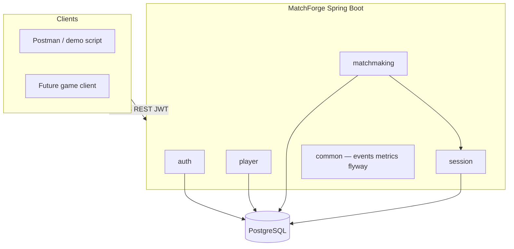
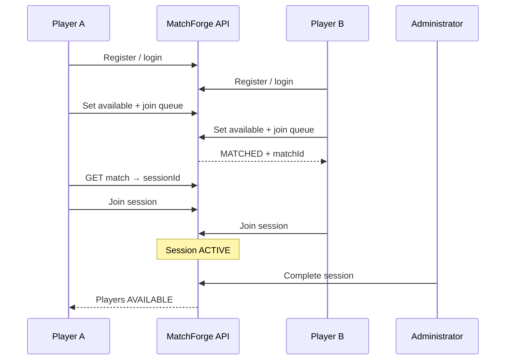
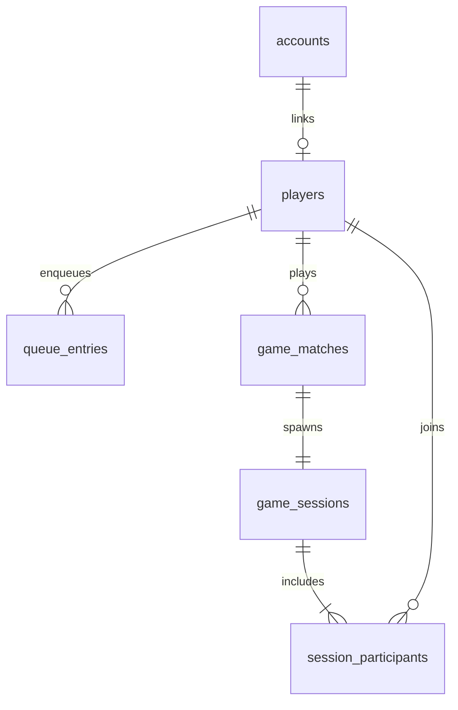

# MatchForge

[](https://github.com/kakumanuharshithsubrahmanyam-wq/MatchForge/actions/workflows/ci.yml)

**MatchForge** is a production-style **multiplayer matchmaking backend**: players register, authenticate with JWTs, enter a skill-aware queue, get paired into matches, and coordinate **game sessions** (join, heartbeat, disconnect/reconnect) until an administrator completes the session.

Built as a portfolio backend (Java 21, Spring Boot, PostgreSQL)—not a game client or dedicated game server.

## Technology stack

| Layer | Choices |
|-------|---------|
| Runtime | Java 21, Spring Boot 4.2, Maven |
| Data | PostgreSQL 16, Spring Data JPA, Flyway |
| Security | Spring Security, JWT (HS256), BCrypt, role-based access |
| Ops | Docker, Docker Compose, Actuator, Micrometer |
| Quality | JUnit 5, Mockito, Testcontainers, GitHub Actions |
| Deployment | Render (Docker), Neon PostgreSQL (see [docs/deployment.md](docs/deployment.md)) |

## Core features

- Player profiles, skill rating, and availability lifecycle
- Skill-based matchmaking with **dynamic rating windows** and scheduled queue processing
- **Concurrency-safe** queue and match creation
- Automatic **game session** creation after a match
- Participant lifecycle: join, heartbeat, disconnect, reconnect
- **JWT authentication** and **PLAYER / ADMIN** authorization
- Flyway schema migrations and Hibernate validate-only mode
- Correlation IDs, metrics, and domain events
- Full CI pipeline with unit, integration, and Testcontainers tests

## Architecture



## Main workflow



## Database design



Tables: `players`, `accounts`, `queue_entries`, `game_matches`, `game_sessions`, `session_participants` (see `src/main/resources/db/migration/`).

## Local installation

**Prerequisites:** JDK 21, Docker (recommended), `curl` and `jq` for demos.

```bash
git clone https://github.com/kakumanuharshithsubrahmanyam-wq/MatchForge.git
cd MatchForge
cp .env.example .env
# Edit .env — set POSTGRES_PASSWORD, MATCHFORGE_JWT_SECRET, MATCHFORGE_ADMIN_*
```

| Environment | JDBC target |
|-------------|-------------|
| App on host | `localhost:5433` (Compose maps Postgres to 5433) |
| App in Compose | `postgres:5432` |
| CI | `localhost:5432` |

```bash
docker compose up -d postgres
export DB_URL=jdbc:postgresql://localhost:5433/matchforge
export DB_USERNAME=matchforge
export DB_PASSWORD=your-password-from-env
export MATCHFORGE_JWT_SECRET=your-local-jwt-secret-at-least-32-chars
export MATCHFORGE_ADMIN_USERNAME=local-admin
export MATCHFORGE_ADMIN_PASSWORD=your-strong-admin-passphrase
./mvnw spring-boot:run
```

Health: `http://localhost:8080/actuator/health`

## Docker

```bash
source scripts/local-docker-path.sh   # if Docker credential helper is missing from PATH
docker compose up --build
```

Application: `http://localhost:8080`. See [ARCHITECTURE.md](ARCHITECTURE.md) for port and Flyway baseline notes.

## Deployment

Hosted setup is **prepared in-repo** (not provisioned automatically):

- [`render.yaml`](render.yaml) — Render Docker web service (free tier, **Singapore**)
- [docs/deployment.md](docs/deployment.md) — Neon PostgreSQL, secrets, verification

**Free-plan limitations:** Render web services spin down when idle (cold start on first request); Neon free tier has compute/storage quotas and scale-to-zero.

## API usage

| Resource | Location |
|----------|----------|
| REST reference | [docs/api-reference.md](docs/api-reference.md) |
| Postman | [postman/MatchForge.postman_collection.json](postman/MatchForge.postman_collection.json) |
| Automated demo | `./scripts/demo-matchforge.sh` |

Demo with admin completion:

```bash
export DEMO_ADMIN_USERNAME=local-admin
export DEMO_ADMIN_PASSWORD=your-admin-passphrase-from-env
./scripts/demo-matchforge.sh http://localhost:8080
```

Swagger UI (`/swagger-ui.html`) is available in **dev**; disabled for anonymous users in **prod**.

## Testing

```bash
source scripts/local-docker-path.sh
docker compose up -d postgres
./mvnw clean verify                    # 99 Surefire + 2 Failsafe (Testcontainers)
./mvnw clean verify -Punit-only        # Skip Testcontainers when Docker unavailable
```

CI on `main`: `./mvnw clean verify`, Docker build. See [.github/workflows/ci.yml](.github/workflows/ci.yml).

## Security

JWT bearer tokens, BCrypt passwords, admin bootstrap via environment variables, Flyway-managed schema, login lockout persistence. Details: [docs/security.md](docs/security.md).

## Limitations

- No game client or real-time gameplay simulation
- No dedicated game server or WebSocket gameplay channel (REST heartbeats only)
- Free Render/Neon tiers are suitable for **demonstration**, not sustained production load
- No invented traffic or performance claims

## Documentation map

| Document | Purpose |
|----------|---------|
| [ARCHITECTURE.md](ARCHITECTURE.md) | Modules, security, matchmaking, sessions |
| [PROJECT_SPEC.md](PROJECT_SPEC.md) | Scope and phase history |
| [docs/project-overview.md](docs/project-overview.md) | Engineering case study |
| [docs/deployment.md](docs/deployment.md) | Render + Neon |
| [docs/api-reference.md](docs/api-reference.md) | API catalog |
| [docs/security.md](docs/security.md) | Threat model and configuration |

## Docker / Testcontainers (local)

Testcontainers **1.21.4** with `docker-java.properties` (`api.version=1.44`) for Docker Engine 29+. Use `scripts/local-docker-path.sh` when `docker-credential-desktop` is not on `PATH`.